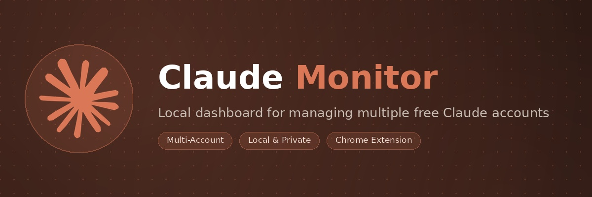
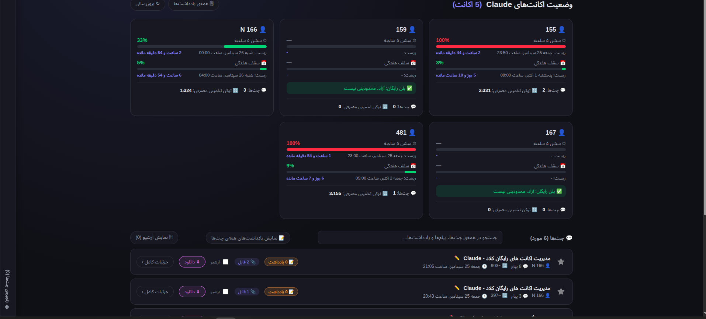
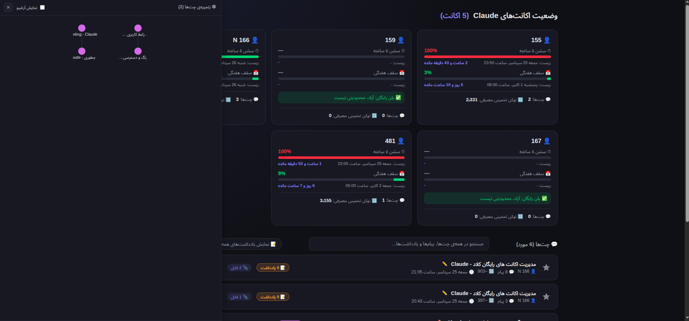

[EN](./README.en.md) | FA
# کلاد مانیتور (Claude Monitor)

ابزاری محلی (Local) برای رصد وضعیت مصرف چند اکانت رایگان Claude (claude.ai) در یک داشبورد واحد. این پروژه از دو بخش تشکیل شده:

1. **اکستنشن مرورگر (Chrome/Chromium/Edge)** — داخل تب‌های باز شده‌ی `claude.ai` اجرا می‌شود، درصد مصرف سشن ۵ ساعته و هفتگی را می‌خواند و به سرور محلی می‌فرستد.
2. **سرور محلی پایتون** — روی سیستم خودتان اجرا می‌شود (`http://localhost:8765`)، اطلاعات همه‌ی اکانت‌هایی که اکستنشن برایش می‌فرستد را ذخیره می‌کند و یک داشبورد وب نمایش می‌دهد.

هیچ داده‌ای به سروری بیرون از سیستم شما ارسال نمی‌شود؛ همه‌چیز کاملاً لوکال است.

---

## قابلیت‌ها

- نمایش درصد مصرف **سشن ۵ ساعته** و **مصرف هفتگی** هر اکانت، به همراه زمان ریست شدن.
- پشتیبانی از **چند اکانت همزمان** (با برچسب دلخواه برای هر کدام، مثلاً `acc1`, `acc2`).
- نمایش لیست چت‌های هر اکانت و برآورد تقریبی تعداد توکن مصرفی هر چت.
- خواندن مستقیم از API داخلی خود claude.ai (با همان کوکی نشست شما)، پس نیازی به وارد کردن پسورد یا توکن جداگانه نیست.
- گوش‌دادن به استریم SSE پیام‌ها برای گرفتن دقیق‌ترین عدد مصرف لحظه‌ای.
- داشبورد وب ساده با کارت جداگانه برای هر اکانت و رنگ‌بندی هشدار (سبز/زرد/قرمز) بر اساس درصد مصرف.
- اجرای خودکار سرور با یک کلیک (آیکون دسکتاپ در لینوکس، میان‌بر Desktop و Start Menu در ویندوز) بدون نیاز به باز کردن ترمینال هر بار.
- زمان ریست شدن سشن و هفته **به وقت محلی کامپیوتر خودتان** نمایش داده می‌شود و با شمارش معکوس کنارش هم‌خوان است.
- **امن و محلی**: سرور فقط روی خود کامپیوتر (`localhost`) گوش می‌دهد و فقط به داشبورد و اکستنشن جواب می‌دهد؛ سایت‌های دیگری که در مرورگر باز هستند نمی‌توانند تاریخچه‌ی چت‌ها را بخوانند.
- **ذخیره‌سازی مطمئن**: داده‌ها به‌صورت اتمیک ذخیره می‌شوند و گزارش ناقص (مثلاً وقتی دریافت چت با خطا مواجه شده یا تب هنوز عددی از استریم نگرفته) چت‌ها و اعداد مصرف قبلی را پاک نمی‌کند.

---

## پیش‌نیازها

- مرورگر مبتنی بر Chromium: **Google Chrome**, **Microsoft Edge**, **Brave** یا مشابه.
- **Python 3** نصب‌شده روی سیستم (نسخه‌ی ۳٫۸ به بالا کافی است).
- حداقل یک اکانت claude.ai که با آن در مرورگر لاگین کرده‌اید.

---





## نصب و راه‌اندازی — گام به گام

### مرحله ۱: نصب اکستنشن مرورگر

از آنجا که این اکستنشن در Chrome Web Store منتشر نشده، باید آن را به‌صورت «Unpacked» (بارگذاری دستی) نصب کنید:

1. پوشه‌ی پروژه (`claude-monitor`) را از حالت فشرده خارج کنید (اگر zip دریافت کرده‌اید).
2. مرورگر Chrome یا Edge را باز کنید و به آدرس زیر بروید:
   - Chrome: `chrome://extensions`
   - Edge: `edge://extensions`
3. گزینه‌ی **حالت توسعه‌دهنده (Developer mode)** را در گوشه‌ی بالا سمت راست (یا چپ، بسته به زبان مرورگر) روشن کنید.
4. روی دکمه‌ی **Load unpacked** (بارگذاری بسته‌نشده) کلیک کنید.
5. در پنجره‌ی باز شده، پوشه‌ی `extension` داخل پوشه‌ی پروژه را انتخاب کنید (نه کل پروژه، فقط پوشه‌ی `extension`).
6. اکستنشن با نام **Claude Multi-Account Monitor** به لیست اضافه می‌شود. آیکون آن را به نوار ابزار مرورگر Pin کنید تا همیشه در دسترس باشد.

> نکته: اگر فایل‌های اکستنشن را بعداً جابه‌جا یا حذف کنید، باید دوباره از مرحله‌ی ۴ تکرار کنید، چون مرورگر مسیر پوشه را به خاطر می‌سپارد.

#### تنظیم برچسب اکانت

برای هر اکانتی که در مرورگر با آن وارد `claude.ai` می‌شوید (مثلاً در پروفایل‌های مختلف کروم یا حالت Incognito چندگانه):

1. روی آیکون اکستنشن در نوار ابزار کلیک کنید.
2. یک نام دلخواه برای این اکانت وارد کنید (مثلاً `acc1`، `کاری`، `شخصی`).
3. روی **ذخیره** کلیک کنید.

این برچسب فقط برای تشخیص اکانت‌ها در داشبورد شماست و به هیچ سروری غیر از سرور محلی خودتان ارسال نمی‌شود.

> نکته: به‌دلایل امنیتی سرور برچسب را «پاک‌سازی» می‌کند: کوتیشن‌ها (`"` و `'`)، بک‌تیک، علامت‌های `<` `>` `&`، بک‌اسلش و کاراکترهای کنترلی حذف می‌شوند، `::` به `:` تبدیل می‌شود و حداکثر ۶۰ کاراکتر نگه داشته می‌شود. بهتر است نام ساده بگذارید (مثل `acc1` یا `کاری`). اگر بعد از پاک‌سازی چیزی نماند، برچسب «بدون‌نام» ثبت می‌شود.

### مرحله ۲: راه‌اندازی سرور محلی

#### روش الف) لینوکس

1. ترمینال را در پوشه‌ی پروژه باز کنید.
2. اسکریپت نصب را یک‌بار اجرا کنید:
   ```bash
   bash install.sh
   ```
3. این اسکریپت یک آیکون به نام **Claude Monitor** روی دسکتاپ و در منوی برنامه‌ها می‌سازد.
4. از این به بعد کافی است روی همان آیکون کلیک کنید؛ سرور به‌صورت خودکار (بدون باز شدن ترمینال) اجرا شده و مرورگر پیش‌فرض شما صفحه‌ی داشبورد را باز می‌کند.
5. لاگ اجرای سرور در فایل `/tmp/claude-monitor.log` نوشته می‌شود.
6. برای خاموش‌کردن سرور: `pkill -f "python3 server.py"`

#### روش ب) ویندوز

1. فایل `install.bat` را (که در پوشه‌ی اصلی پروژه، کنار پوشه‌ی `server` است) دوبار کلیک کنید. نیازی به «Run as administrator» نیست.
2. این اسکریپت پایتون ۳ شما را پیدا می‌کند و یک میان‌بر (Shortcut) به نام **Claude Monitor** روی دسکتاپ و در Start Menu می‌سازد.
3. از این پس با دابل‌کلیک روی میان‌بر، سرور به‌صورت مخفی (بدون پنجره‌ی CMD) اجرا شده و داشبورد در مرورگر پیش‌فرض شما باز می‌شود.
4. لاگ سرور در `%TEMP%\claude-monitor.log` نوشته می‌شود.
5. برای خاموش‌کردن سرور، در پوشه‌ی پروژه (در CMD یا PowerShell) این دستور را اجرا کنید:
   ```bat
   py -3 launcher.pyw --stop
   ```
   (اگر `py` ندارید: `python launcher.pyw --stop`.) راه آخر: در Task Manager فرایند `python.exe` مربوط به سرور را ببندید.

> **نکته:** میان‌بر، مسیر پوشه‌ی پروژه و مسیر پایتون را به‌صورت مطلق ذخیره می‌کند. اگر پوشه‌ی پروژه را جابه‌جا یا تغییر نام دادید، یا پایتون را عوض/حذف کردید، یک‌بار دیگر `install.bat` را اجرا کنید تا میان‌بر دوباره ساخته شود.

**نقش فایل‌های ویندوز** (هر سه لازم‌اند؛ چیزی برای حذف نیست):

| فایل | کار |
|---|---|
| `install.bat` | فقط یک‌بار دوبار‌کلیک می‌شود؛ پایتون واقعی را پیدا می‌کند و `install_windows.py` را اجرا می‌کند |
| `install_windows.py` | میان‌بر Desktop و Start Menu را (با آیکون `.ico`) می‌سازد؛ پوشه‌ی Desktop را حتی اگر OneDrive/فارسی باشد درست پیدا می‌کند |
| `launcher.pyw` | کاری که میان‌بر هر بار اجرا می‌کند: سرور را مخفی بالا می‌آورد، مرورگر را باز می‌کند و با `--stop` سرور را می‌بندد |
| `assets/claude-monitor.ico` | آیکون میان‌بر (ویندوز برای میان‌بر فقط `.ico` را قبول می‌کند، نه `.png`) |
| `.gitattributes` | نگه‌داشتن `install.bat` با پایان‌خط CRLF؛ بدون آن `cmd.exe` فایل را اشتباه می‌خواند |

> `install.bat` فقط یک «در ورودی» ساده برای دوبار کلیک است. کار اصلی (ساخت میان‌بر) را `install_windows.py` انجام می‌دهد.

**اگر `install.bat` روی سیستم شما کار نکرد** (پنجره بسته شد، خطا داد یا میان‌بر ساخته نشد)، مستقیم با پایتون نصب کنید:

1. پایتون ۳.۸+ را از [python.org](https://www.python.org/downloads/) نصب کنید.
2. در پوشه‌ی پروژه، در نوار آدرس Explorer بنویسید `cmd` و Enter بزنید (یا CMD/PowerShell را همان‌جا باز کنید).
3. این دستور را اجرا کنید:
   ```bat
   py -3 install_windows.py
   ```
   (اگر `py` ندارید: `python install_windows.py`.) حتماً از داخل CMD اجرا کنید، نه دوبار کلیک؛ چون با دوبار کلیک پنجره بعد از پایان بسته می‌شود و پیام خطا را نمی‌بینید.
4. بعد از ساخته‌شدن میان‌بر، مثل حالت عادی از Desktop یا Start Menu استفاده کنید.

اگر میان‌بر هم ساخته نشد، بدون هیچ نصبی می‌توانید مستقیم اجرا کنید: `py -3 launcher.pyw` (سرور را مخفی بالا می‌آورد و داشبورد را باز می‌کند) یا روش دستی (روش پ) که پایین‌تر آمده است.

> پیش‌نیاز ویندوز: پایتون ۳.۸ یا بالاتر (از [python.org](https://www.python.org/downloads/)). فعال‌بودن «Add python.exe to PATH» لازم نیست (نصب‌کننده پایتون را از طریق `py` هم پیدا می‌کند)، اما اگر پایتون نصب نباشد ویندوز ۱۰/۱۱ ممکن است برای `python` فقط یک میان‌بر مایکروسافت‌استور داشته باشد که پایتون واقعی نیست و کافی نیست. با دستور `py -3 --version` بررسی کنید.

#### روش پ) اجرای دستی (هر سیستم‌عاملی)

اگر نمی‌خواهید از اسکریپت نصب استفاده کنید:

```bash
cd server
python3 server.py
```

سپس در مرورگر به آدرس `http://localhost:8765` بروید.

### مرحله ۳: بررسی اتصال

1. یک تب جدید در claude.ai باز کنید و وارد اکانت شوید.
2. یک پیام به Claude بفرستید یا وارد صفحه‌ی استفاده (Usage) شوید.
3. به داشبورد (`http://localhost:8765`) برگردید و صفحه را رفرش کنید؛ باید کارت مربوط به این اکانت با برچسبی که انتخاب کردید ظاهر شود.
4. اگر چیزی نمایش داده نشد، Console مرورگر را در تب claude.ai باز کنید (کلید F12) و دنبال پیام‌های `[ClaudeMonitor:...]` بگردید تا خطای احتمالی مشخص شود (معمولاً یعنی سرور روشن نیست).

---

## به‌روزرسانی پروژه

هر بار نسخه‌ی جدید پروژه را جایگزین نسخه‌ی قبلی کردید:

1. سرور را خاموش کنید (`py -3 launcher.pyw --stop` در ویندوز، `pkill -f "python3 server.py"` در لینوکس) و دوباره از میان‌بر/آیکون اجرا کنید؛ چون `server.py` تغییر کرده است.
2. در `chrome://extensions` (یا `edge://extensions`) روی دکمه‌ی **Reload** اکستنشن بزنید و تب‌های `claude.ai` را رفرش کنید؛ چون `content.js` تغییر کرده است.
3. فایل `server/status.json` (تاریخچه‌ی شما) را جایگزین یا پاک نکنید.

## توقف و حذف کامل

- **توقف سرور:** مثل بخش بالا (`launcher.pyw --stop` در ویندوز).
- **حذف در ویندوز:** دو فایل `Claude Monitor.lnk` را از Desktop و از پوشه‌ی Start Menu → Programs پاک کنید، سپس پوشه‌ی پروژه را حذف کنید.
- **حذف در لینوکس:** فایل‌های `~/.local/share/applications/claude-monitor.desktop` و کپی روی دسکتاپ و فایل `claude-monitor-launch.sh` داخل پوشه‌ی پروژه را پاک کنید.
- **حذف اکستنشن:** در `chrome://extensions` روی **Remove** بزنید.
- **داده‌ها:** همه‌چیز در `server/status.json` است. اگر می‌خواهید تاریخچه بماند، قبل از حذف پوشه از آن نسخه‌ی پشتیبان بگیرید.

---

## سوالات متداول

**آیا این کار خلاف قوانین Anthropic است؟**
این ابزار فقط داده‌ی مصرف اکانت‌های خود شما را که از طریق نشست لاگین‌شده‌ی مرورگرتان در دسترس است می‌خواند؛ هیچ دور زدن محدودیت یا اتوماسیون ارسال پیام انجام نمی‌دهد. مسئولیت رعایت شرایط استفاده‌ی Anthropic بر عهده‌ی خود کاربر است.

**چرا باید هر بار پورت ۸۷۶۵ باز باشد؟**
سرور و اکستنشن فقط از طریق `localhost:8765` با هم صحبت می‌کنند. اگر پورت توسط برنامه‌ی دیگری اشغال شده است، عدد پورت را در **همه‌ی** این جاها یکسان تغییر دهید:

- `server/server.py` (مقدار `PORT`)
- `extension/manifest.json` و `extension/background.js`
- `launcher.pyw` (مقدار `PORT`، در ویندوز)
- `install.sh` (مقدار `PORT`، در لینوکس؛ بعد از تغییر یک‌بار دوباره `bash install.sh` را اجرا کنید)

سپس اکستنشن را Reload کنید و سرور را دوباره اجرا کنید.

**داده‌ها کجا ذخیره می‌شوند؟**
در فایل `server/status.json` کنار خود سرور، به‌صورت متنی (JSON) و کاملاً روی سیستم شما. این فایل شامل متن چت‌هاست؛ آن را برای کسی نفرستید و داخل Git/زیپ قرار ندهید (در `.gitignore` هست).

اگر فایل به هر دلیلی خراب شود، سرور آن را حذف نمی‌کند و یک کپی با نام `status.json.corrupt-<تاریخ-ساعت>` کنارش نگه می‌دارد تا بتوانید داده‌ها را برگردانید.

**چرا سرور یا اکستنشن خطای `403 forbidden` می‌دهد؟**
این رفتار عمدی است. سرور فقط درخواست‌هایی را قبول می‌کند که `Host` آن‌ها `localhost:8765` یا `127.0.0.1:8765` باشد و از طرف خودِ داشبورد یا اکستنشن بیایند (یا بدون `Origin`، مثل باز کردن مستقیم آدرس در مرورگر). باز کردن داشبورد با IP شبکه‌ی محلی یا نام دیگر، و درخواست از سایت‌های دیگر، رد می‌شود.

**در ویندوز با میان‌بر چیزی باز نمی‌شود یا پیام «سرور بالا نیامد» می‌آید؟**
۱) فایل لاگ را باز کنید: در نوار آدرس Explorer بنویسید `%TEMP%\claude-monitor.log`. ۲) رایج‌ترین دلیل‌ها: پورت ۸۷۶۵ توسط برنامه‌ی دیگری اشغال است (`netstat -ano | findstr :8765`) یا پایتون جابه‌جا/حذف شده است؛ در این حالت `install.bat` را دوباره اجرا کنید. ۳) روی لینوکس/مک خطای «Address already in use» بعد از خاموش‌کردن سرور دیگر پیش نمی‌آید.
